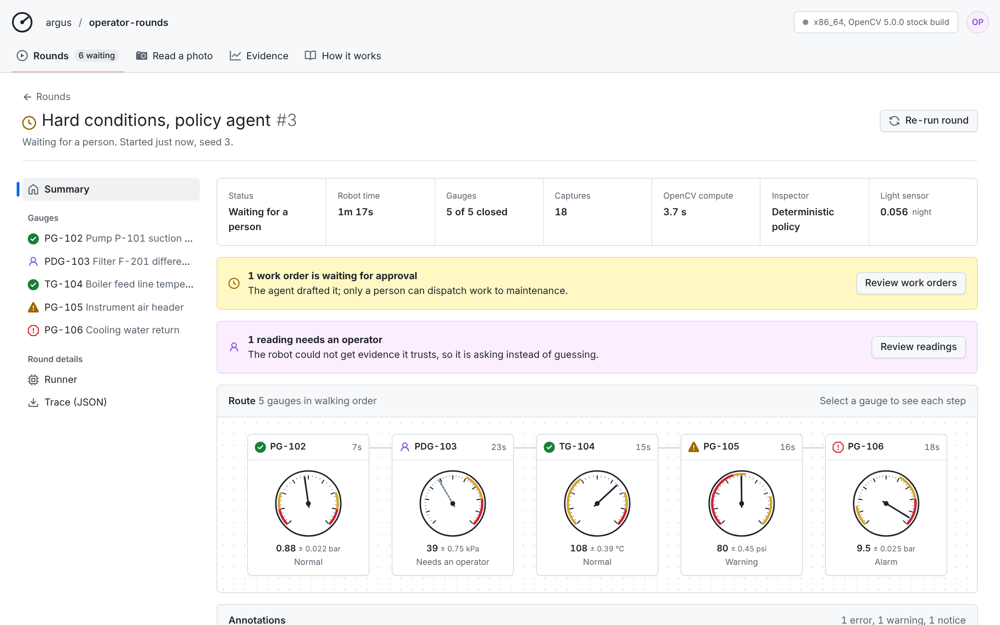
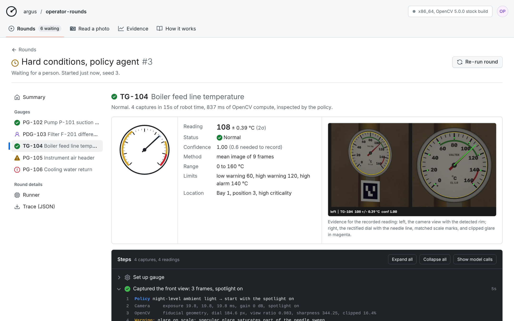

# ARGUS

**Operator rounds that know when not to trust their own eyes.** An inspection robot reads analog gauges with **OpenCV 5** running on **AWS Graviton4 with the Cloud-Optimized OpenCV Library (COOL)**. When the evidence is bad, an agent on **Amazon Bedrock** changes how it looks; when it still is not good enough, it hands the gauge to a person.





Analog gauges are everywhere in brownfield plants, and automated readings fail *silently* under glare, vibration, night-time noise, oblique mounting and occlusion. ARGUS:

1. measures every capture with OpenCV 5: fiducial homography, pivot re-centring, polar needle detection, scale verification and a calibrated ±2σ;
2. lists exactly what is wrong with the evidence;
3. acts on it: moves to shift a reflection, brackets exposures, freezes flutter, controls its light;
4. records only trustworthy values, drafts work orders for alarms, and escalates the rest with evidence.

A deterministic safety guard enforces the rules for every caller, and people approve every dispatch.

## Results (ground truth, 300 gauge inspections per strategy)

| | Wide shot | Fixed PTZ (naive) | Fixed PTZ + gating | **ARGUS policy agent** |
|---|---|---|---|---|
| Silent failures (wrong value recorded) | 25.3% | 32.0% | 1.7% | 0.0% |
| Missed alarms / instrument faults | 7 of 69 | 15 of 69 | 0 of 69 | 0 of 69 |
| False work orders | 21 | 33 | 0 | 0 |
| Read automatically | 26.7% | 100.0% | 61.7% | 92.0% |
| Recorded within ±1% of span | 1.3% | 60.7% | 89.8% | 99.6% |
| Median error (% of span) | 39.505 | 0.141 | 0.069 | 0.061 |
| Truth inside reported ±2σ | 7.8% | 58.5% | 85.6% | 98.0% |
| Status correct (recorded) | 27.5% | 76.0% | 100.0% | 100.0% |
| Captures per gauge | 0.20 | 1.00 | 1.00 | 2.01 |
| Robot seconds per gauge | 0.6 | 5.6 | 5.6 | 9.7 |

Reader precision on clean frames: median **0.057%** of span (0.154°). The COOL vs stock OpenCV 5 benchmark on the same Graviton4 instance is in [`results/bench/compare.md`](results/bench/compare.md), produced by `deploy/run_bench.sh` (TODO-AWS).

## Rubric map

| Criterion | Where to look |
|---|---|
| **Technical execution** (30%) | [`argus/vision/perception.py`](argus/vision/perception.py) (OpenCV 5 pipeline), [`argus/vision/pipeline.py`](argus/vision/pipeline.py), [`docs/REPORT.md` §3, §5](docs/REPORT.md), 19 tests in [`tests/`](tests/), [`eval/run_eval.py`](eval/run_eval.py) |
| **Innovation** (20%) | Active perception from quality evidence: glare as mirror geometry (move to clear it), flutter midrange from fast bursts, hub re-centring, uncertainty-aware limit checks. Physics-based robot simulator with ground truth ([`argus/vision/sim.py`](argus/vision/sim.py)). |
| **Real-world impact** (20%) | Silent failures and missed alarms vs naive automation (table above); human workload (escalation rate); robot seconds per gauge; [`docs/REPORT.md` §1, §5](docs/REPORT.md) |
| **User experience** (10%) | Console modelled on GitHub Actions run pages, which most technical users already know: rounds list with *Run round*, round summary with a live route graph (dials with ±2σ cones), gauge pages as step logs with the agent's reasoning, *Review work orders* / *Review readings* gates, follow-live mode, shareable links, photo mode with retake guidance. Keyboard and screen-reader friendly, status as icon plus text, light and dark themes, phone layout |
| **Documentation** (10%) | [`docs/REPORT.md`](docs/REPORT.md), [`docs/DEPLOY.md`](docs/DEPLOY.md), [`docs/img/architecture.png`](docs/img/architecture.png), [`docs/img/agent_workflow.png`](docs/img/agent_workflow.png), video |
| **Cloud delivery, reproducibility, responsible operation** (10%) | [`deploy/cloudformation.yaml`](deploy/cloudformation.yaml) (CloudFront, origin secret plus prefix list, IMDSv2, least-privilege IAM, encrypted S3 and EBS, budget, alarms, auto-recovery), one-command scripts, pinned dependencies, CloudWatch trace logs and dashboard, [`docs/REPORT.md` §7](docs/REPORT.md) |
| **Best Use of COOL: verified on Graviton** | `/api/runtime` (cv2 path `/opt/cool`, OpenCV 5, Neoverse-V2, instance type, product code), the console's runner badge and Runner dialog, [`deploy/bootstrap.sh`](deploy/bootstrap.sh) verification |
| **COOL: architecture, measured value, reproducibility** | [`bench/`](bench/): identical inputs, full-pipeline latency and throughput, 17 ops, same-instance stock baseline and x86 baseline, $/1k reads; [`deploy/run_bench.sh`](deploy/run_bench.sh), [`deploy/bench_x86.sh`](deploy/bench_x86.sh) |
| **Agentic Vision: OpenCV 5 and agent** | Bedrock Converse tool-use loop [`argus/agent/llm.py`](argus/agent/llm.py) over OpenCV tools [`argus/agent/tools.py`](argus/agent/tools.py); MCP server [`argus/mcp_server.py`](argus/mcp_server.py) |
| **Agentic: orchestration and autonomy, task effectiveness** | Per-gauge perception→decision→action loop, lessons across gauges, budgets; evaluation table; downloadable traces where OpenCV output changes the next tool call (rows marked "Re-planned from what it saw") |
| **Agentic: failure handling, observability, human control** | [`argus/agent/guard.py`](argus/agent/guard.py), policy fallback and circuit breaker, CloudWatch logs, metrics and alarm, human review and approval endpoints |

## Quick start

```bash
pip install -r requirements-dev.txt
python -m pytest -q                                   # 19 tests
python -m uvicorn argus.server.app:app --port 8080     # http://localhost:8080
python -m eval.run_eval --scenes 30                    # reproduce the table
```

Deploy to AWS in one command from CloudShell: [`docs/DEPLOY.md`](docs/DEPLOY.md).

## Repository

```
argus/vision/   OpenCV 5 perception (perception.py, pipeline.py), simulator (sim.py, textures.py), privacy (YuNet)
argus/agent/    tools, safety guard, policy agent, Bedrock LLM inspector, supervisor, report
argus/server/   FastAPI service, AWS sinks (S3, CloudWatch, SNS)
argus/mcp_server.py   the same tools over MCP
web/            operator console (no build step; Primer tokens and Octicons, MIT)
eval/           ground-truth evaluation;  bench/  COOL benchmark
deploy/         CloudFormation + deploy / update / bench / eval / teardown scripts
docs/           report, deploy guide, video script, Devpost text, submission checklist
results/        evaluation outputs (results/eval/final) and benchmark outputs (results/bench)
```

## Design credit

The console's information architecture follows GitHub Actions run pages: a list of runs, a run summary with a job graph, job pages with step logs, and a review gate for anything a person must approve. Colours, radii and type come from GitHub's open-source [Primer primitives](https://github.com/primer/primitives) and icons from [Octicons](https://github.com/primer/octicons), both MIT-licensed. ARGUS is not affiliated with GitHub.

Licence: MIT (see `LICENSE`). Imagery is rendered by the project; the YuNet face model is from the OpenCV Zoo (MIT). See `THIRD_PARTY_NOTICES.md`.
