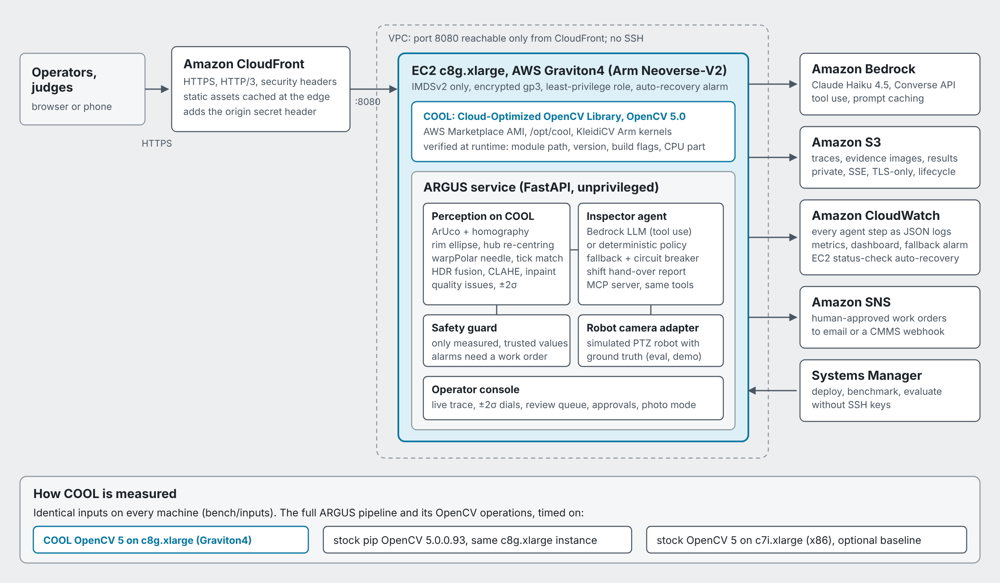
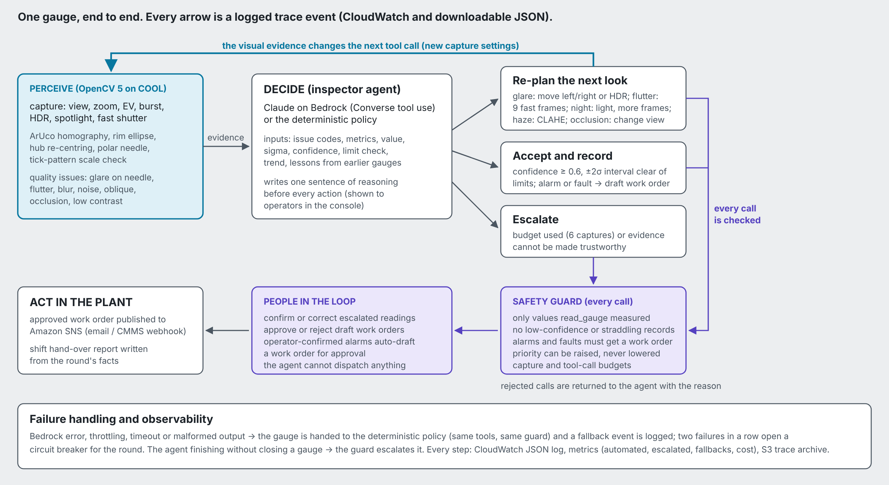
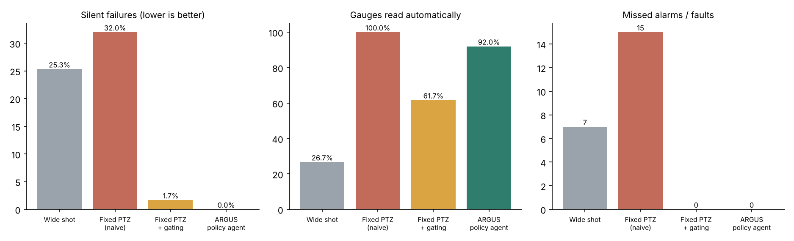

# ARGUS: operator rounds that know when not to trust their own eyes

**OpenCV AI Competition 2026 — technical report.** Featured paths: Agentic Vision with OpenCV 5, and Cloud-Optimized Vision with COOL.

## 1. Problem and users

Brownfield process plants run on analog instruments. Pressure, temperature and differential-pressure gauges are read by operators on scheduled rounds and written on paper or into a tablet. Rounds are labour-intensive and repetitive, and they are often in noisy, hot or hard-to-reach places. Readings are only as good as the walk, and an abnormal value can sit unnoticed until the next round.

Robots and fixed cameras can photograph gauges, but automated reading fails under exactly the conditions of a real plant floor:

- specular glare on the glass
- needle flutter from pump pulsation and body vibration
- night-time noise
- oblique mounting
- cables or tags hanging in front of a dial
- dirty glass

The worst failure is the **silent** one: a wrong number recorded with confidence.

**Users.** Operations teams who run rounds, reliability and maintenance engineers who act on findings, and control-room operators who arbitrate doubtful readings.

**What ARGUS does.** An inspection agent drives a robot-mounted PTZ camera. It:

- measures each gauge with OpenCV 5;
- judges whether the evidence can be trusted;
- **changes how it looks** when it cannot: moves to shift a reflection, brackets exposures, freezes vibration, controls its light;
- records only trustworthy values;
- drafts work orders for alarms and faults;
- escalates the rest to a person with the evidence attached.

People confirm readings and approve every dispatch.

## 2. Architecture



| Component | Implementation |
|---|---|
| Edge | Amazon CloudFront, HTTPS and HTTP/3, managed security headers, static caching. It sends a secret origin header; the origin rejects requests without it and its port is restricted to CloudFront's managed prefix list. |
| Compute | EC2 **c8g.xlarge (AWS Graviton4, Neoverse-V2)** launched from the **COOL Graviton4 Marketplace AMI (OpenCV 5.0)**. IMDSv2 only, encrypted gp3, least-privilege instance role, no SSH (Systems Manager), status-check auto-recovery. |
| Service | FastAPI under systemd as an unprivileged user. Single process, bounded worker pool, per-IP rate limits, daily LLM cap. |
| Agent | Amazon Bedrock **Converse API with tool use**, Claude Haiku 4.5 by default (configurable), prompt caching. A deterministic policy uses the same tools; it is the fallback and the no-LLM mode. |
| Evidence | Amazon S3: every round's trace JSON and evidence images (private, SSE-S3, TLS-only, 60-day lifecycle). |
| Observability | CloudWatch Logs: every trace event as one JSON line (perception, decision, guard, human). Metrics: automated, escalated, work orders, compute ms, LLM calls, cost, fallbacks. A dashboard with a Logs Insights decision table, and an alarm on LLM fallbacks. |
| Action | Amazon SNS publishes human-approved work orders (email or a CMMS webhook). |
| Delivery | One CloudFormation template (`deploy/cloudformation.yaml`, cfn-lint clean). One-command deploy, update, benchmark and evaluation scripts run over SSM. |
| Cost control | AWS Budget with email alerts, LLM daily cap, per-IP limits, a 2-round concurrency cap. |

The **robot camera adapter** is the boundary between ARGUS and hardware. The adapter in this submission is a physics-based simulator with ground truth (section 5). The tools the agent sees would be the same with a real PTZ camera.

## 3. OpenCV 5 implementation

All perception runs in OpenCV 5 (`argus/vision/perception.py`, `pipeline.py`). Per capture:

1. **Localize.**
   - ArUco `DICT_4X4_50` detection (`cv2.aruco.ArucoDetector`, sub-pixel corners) on the gauge's tag.
   - The four corners give the homography from dial-face millimetres to the image (`getPerspectiveTransform`).
   - Without a tag, the robot's pose prediction is snapped to the dial with `HoughCircles(HOUGH_GRADIENT_ALT)`.
   - For user photos there is no prediction: a global Hough search, with the dial's roll recovered later from the scale.
2. **Rectify.**
   - `warpPerspective` to a canonical 512 px fronto-parallel dial.
   - Rim refinement: a radial edge search in `warpPolar` space, then `fitEllipse` with outlier trimming, then an affine ellipse-to-circle correction. It is accepted only within method-specific limits on shift, anisotropy and residual, because a fiducial homography is already accurate to about 1 px.
   - **Hub re-centring:** `HoughCircles` finds the needle's hub cap and the dial is re-centred on the true pivot. This matters because a 4–8 px pivot error biases a polar needle angle by degrees, and tick calibration cannot see a translation.
3. **Read.**
   - The dial is unwrapped with `warpPolar` (720 angle bins × 240 radii).
   - A darkness map, plus a redness channel for red needles, is normalised per radius.
   - The needle is the angle with the highest radial *coverage* in a band clear of numerals and ticks, with parabolic sub-bin refinement.
   - An independent robust `fitLine` (Huber) on the needle pixels checks that the structure is a straight radial needle through the pivot.
   - **Scale verification:** the expected major-tick pattern is cross-correlated with the observed tick band. This yields a rotation correction (±12°, or ±180° for photos) and a match score. A stop-pin position flags *instrument fault*; past full scale flags *over-range*.
4. **Uncertainty.**
   - σ combines a floor, the needle-peak width, method disagreement and the tick-fit residual.
   - Bursts are fused per frame: median for static needles, and for flutter the **outlier-trimmed midrange**, the efficient centre estimator for an oscillation sampled at random phases (arcsine distribution). Flutter amplitude is reported as a pulsation signal.
   - HDR brackets are aligned with `AlignMTB` and fused with `MergeMertens`. Optional `CLAHE`, Telea `inpaint` and `fastNlMeansDenoisingColored` are available.
5. **Assess.** Quality issues are computed from the same pass:

   | Issue | Measured by |
   |---|---|
   | resolution | dial radius in pixels |
   | obliqueness | projected-circle axis ratio |
   | defocus vs motion blur | normalised Laplacian variance; structure-tensor anisotropy separates the two |
   | glare on the sweep / on the needle | polar map of clipped pixels |
   | overexposure | face clipped fraction |
   | noise | Immerkær estimator |
   | contrast | face percentile range |
   | occlusion | rim coverage |
   | needle evidence | strength, peak ratio |
   | scale match | tick score |
   | flutter or inconsistent frames | per-frame spread |

   Each issue multiplies the reader's confidence by a penalty. A clean peak inside a glare blob, or on an unverified geometry, is not a trustworthy measurement.
6. **Privacy.** User photos pass through OpenCV 5's DNN engine (`FaceDetectorYN`, YuNet ONNX) and faces are blurred before anything else.

Precision on clean frames is median **0.057%** of span (p90 0.095%) on 48 captures (`tests/test_vision.py`).

## 4. The agent: perception → decision → action



**Tools.** `capture`, `read_gauge`, `record_reading`, `request_human_review`, `create_work_order` and `finish_gauge` (`argus/agent/tools.py`) are shared by four callers: the Bedrock LLM inspector, the deterministic policy, the MCP server (Claude Code, Kiro) and the HTTP API.

`capture` exposes real camera decisions:

- view (front, left or right on the walkway)
- zoom and EV bias
- burst length
- HDR bracket
- spotlight
- fast shutter

Its result includes OpenCV's issue codes. `read_gauge` returns value, σ, confidence, the penalties applied, and a **limit check that accounts for uncertainty**: an interval straddling a limit is "uncertain", not "normal".

**Why the visual evidence changes what happens next.** Glare is a mirror reflection, so the agent moves and the reflection leaves the needle; the simulator reproduces this geometry exactly. More examples:

| What OpenCV reported | What the agent did next |
|---|---|
| Flutter detected across three frames | Next capture: nine fast-shutter frames |
| The robot's own spotlight produced glare | Light off, more frames instead |
| Haze | CLAHE before taking another picture |
| An interval straddling an alarm limit | More frames to tighten σ, or escalation |

These re-plans are labelled *Re-planned from what it saw* in each gauge's step log in the console, and appear in the trace as `tool_call` events with the agent's one-sentence rationale.

**LLM inspector** (`argus/agent/llm.py`):

- One Converse conversation per gauge keeps context small and cheap.
- The system prompt contains the camera physics and the rules.
- Lessons from earlier gauges in the round are passed forward.
- Tool results are JSON.
- Per-call usage and cost are tracked.
- On any Bedrock error, timeout, malformed output, or turn-budget exhaustion, the gauge is handed to the policy agent and a `fallback` event is logged. Two consecutive failures open a circuit breaker for the round.
- After the round, the LLM writes the shift hand-over from the round's facts only; a template is the fallback.

**Safety guard** (`argus/agent/guard.py`). Deterministic and applied to every caller:

- only values produced by `read_gauge` can be recorded (by `reading_id`);
- no record below confidence 0.6, or with an interval straddling a limit;
- alarm and fault gauges cannot be closed without a work order;
- work-order priority can be raised to a policy floor, never lowered;
- duplicate work orders are rejected;
- capture and tool-call budgets;
- an alarm seen in any reasonably confident reading cannot be silently dropped.

Rejected calls go back to the agent with the reason. People confirm or correct escalations in the console, and only people approve dispatch; an operator-confirmed alarm auto-drafts a work order for approval.

**Console.** The operator console reuses the information architecture of GitHub Actions run pages, chosen because it is a widely used, human-designed interface for exactly this job: watching an automated run step by step and approving gated actions.

| Actions concept | ARGUS |
|---|---|
| Run workflow, with inputs | Run round: plant conditions, inspector, seed |
| Run summary and job graph | Round summary: status, route graph with live dials and ±2σ cones, annotations, approvals, shift hand-over, artifacts |
| Job page with step logs | Gauge page: each capture, reading and guard decision as a step with the agent's reasoning, OpenCV's quality warnings and evidence images |
| Review deployments | Review work orders (approve and dispatch, or reject) and Review readings (confirm, enter a value, or send someone to check) |
| Runner details | Runner dialog: the OpenCV build, its path, CPU and EC2 instance |

It uses GitHub's open-source Primer design tokens and Octicons (MIT). It supports keyboard use, screen readers (status always as icon plus text), light and dark themes, and phones.

## 5. Evaluation

**Method** (`eval/run_eval.py`). There is no public dataset of gauge photos with exact ground truth under controlled glare, vibration and lighting, and robot experiments must be *repeatable*. So ARGUS includes a physics-based simulator (`argus/vision/sim.py`):

- **Optics:** a pinhole PTZ camera with real homographies, and per-gauge 3D mounting (yaw, pitch, roll).
- **Glare:** specular glare computed by mirror geometry, so it moves when the camera moves.
- **Sensor:** a shot-noise and read-noise model with gain, clipping and gamma; JPEG compression; autofocus failures.
- **Motion:** shutter-dependent motion blur; needle flutter at 4–12 Hz.
- **Occlusion:** occluders in a plane 70 mm in front of the dial (parallax).
- **Glass:** haze.
- **Faults:** stuck-on-stop-pin and over-range.
- **Process context:** process values sampled across normal, warning, alarm and near-limit bands.

Ground truth never reaches the agent's tools. Results use seeds 1–60. The uncertainty model was tuned on separate development seeds.

**Strategies compared.** 300 gauge inspections per strategy across 60 rounds:

- **Wide shot:** one overview frame of the panel, every value accepted.
- **Fixed PTZ (naive):** one frontal auto-exposed frame per gauge, value accepted. This is what a scripted robot round does.
- **Fixed PTZ + gating:** the same frame, but escalate when ARGUS's gated confidence < 0.6. This shows the value of the uncertainty model alone.
- **ARGUS policy agent:** active perception, guard, escalation.
- **ARGUS LLM agent (Bedrock):** the same, with Claude choosing actions. Run on AWS on the first N rounds (section 5.3).

### 5.1 Results

| | Wide shot | Fixed PTZ (naive) | Fixed PTZ + gating | **ARGUS policy agent** |
|---|---|---|---|---|
| Silent failures (wrong value recorded) | 25.3% | 32.0% | 1.7% | 0.0% |
| Missed alarms / instrument faults | 7 of 69 | 15 of 69 | 0 of 69 | 0 of 69 |
| False work orders | 21 | 33 | 0 | 0 |
| Read automatically | 26.7% | 100.0% | 61.7% | 92.0% |
| Recorded within ±1% of span | 1.3% | 60.7% | 89.8% | 99.6% |
| Median error (% of span) | 39.505 | 0.141 | 0.069 | 0.061 |
| Truth inside reported ±2σ | 7.8% | 58.5% | 85.6% | 98.0% |
| Status correct (recorded) | 27.5% | 76.0% | 100.0% | 100.0% |
| Captures per gauge | 0.20 | 1.00 | 1.00 | 2.01 |
| Robot seconds per gauge | 0.6 | 5.6 | 5.6 | 9.7 |

*Silent failure:* a value recorded automatically that is wrong by more than 2% of span, or a faulted gauge recorded as healthy. *Missed alarm/fault:* a truly critical gauge with neither a work order nor an escalation.



**Reading the table.**

- Naive automation reads everything and is wrong silently in about 32% of cases. It misses 15 of 69 critical gauges and raises 33 false work orders.
- Uncertainty gating alone removes most silent failures, but only by escalating 38% of gauges to people.
- Active perception recovers most of those: the agent reads **92%** automatically with **0 silent failures**, **0 missed alarms/faults** and **0 false work orders**.
- 99.6% of its recorded readings are within ±1% of span.
- Its reported ±2σ interval contains the truth 98% of the time, so the uncertainty is calibrated rather than decorative.
- The cost is about 2.0 captures and 10 s of robot time per gauge.

### 5.2 By condition

| Condition (gauges) | Fixed PTZ (naive) | Fixed PTZ + gating | ARGUS policy agent |
|---|---|---|---|
| clean (68) | 100% auto, 1 silent, 0 missed | 98% auto, 0 silent, 0 missed | 100% auto, 0 silent, 0 missed |
| glare (104) | 100% auto, 75 silent, 15 missed | 16% auto, 1 silent, 0 missed | 92% auto, 0 silent, 0 missed |
| night (70) | 100% auto, 35 silent, 8 missed | 46% auto, 1 silent, 0 missed | 94% auto, 0 silent, 0 missed |
| vibration (61) | 100% auto, 31 silent, 4 missed | 46% auto, 5 silent, 0 missed | 82% auto, 0 silent, 0 missed |
| oblique (64) | 100% auto, 23 silent, 5 missed | 58% auto, 0 silent, 0 missed | 94% auto, 0 silent, 0 missed |
| occlusion (31) | 100% auto, 18 silent, 3 missed | 23% auto, 0 silent, 0 missed | 48% auto, 0 silent, 0 missed |
| haze (40) | 100% auto, 13 silent, 2 missed | 60% auto, 1 silent, 0 missed | 90% auto, 0 silent, 0 missed |
| fault (23) | 100% auto, 5 silent, 5 missed | 78% auto, 0 silent, 0 missed | 100% auto, 0 silent, 0 missed |

Escalations concentrate where they should: occluded dials and severe combinations. A gauge with a cable across its needle *should* go to a person if two side views cannot clear it.

### 5.3 LLM agent on Amazon Bedrock

TODO-AWS: paste the `agent_llm` and `agent_policy_same_seeds` columns from `./deploy/run_eval.sh --scenes 30 --llm-scenes 8` (`results/eval/aws/summary.json`). Report automation, silent failures, missed alarms, captures per gauge, LLM cost per gauge and fallbacks. State plainly whether it beats the policy on each metric. The LLM's distinctive contributions are:

- explanations operators read before every action;
- specific work-order text;
- lessons carried between gauges;
- the shift report.

### 5.4 Failure cases and limitations

- **Failure gallery.** `results/eval/final/gallery/` holds evidence overlays of escalations and the largest recorded errors. The dominant escalation causes are:
  - a cable or tag crossing the needle from every view;
  - glare plus a very oblique mount, where the side that clears the glare is the steep side;
  - vibration plus night, where fast shutter needs gain and the frames stay noisy.
- **Sim-to-real gap.** The simulator models the physics that make gauge reading hard, but it is not a real plant. Real lenses add distortion; real dials vary in typography, colour bands and needle shapes. Photo mode (`/api/analyze`) runs the same pipeline on real photos without a tag and refuses to accept a reading when it cannot verify the scale. It needs site-specific validation before production use.
- **Calibration source.** The registry supplies range and angles; the tick-pattern check verifies them. Unusual scales (non-linear, multi-scale dials) are out of scope.
- **Hardware.** The camera adapter is simulated. A real deployment needs an adapter for the robot's PTZ API, and ArUco tags (or registry poses) per gauge.

## 6. COOL on AWS Graviton

**Verified execution.** At runtime `/api/runtime` reports:

- the `cv2` module path (COOL installs under `/opt/cool`) and OpenCV version;
- build highlights (custom HAL, KleidiCV);
- CPU part `0xd4f` (Neoverse-V2, Graviton4) from `/proc/cpuinfo`;
- instance type and Marketplace product code from IMDSv2.

The console shows them in its runner badge and Runner dialog. `deploy/bootstrap.sh` refuses to call an environment "COOL" unless `cv2` loads from `/opt/cool` and reports 5.x, both before and after installing the app's dependencies. Those dependencies are pinned so COOL's numpy and cv2 are never replaced.

**Method** (`bench/`):

- Identical inputs on every machine: 24 rendered captures plus a 9-frame burst (`bench/inputs`).
- The *real workload* is timed: `analyze_capture` (localize, rectify, refine, read, assess) single-process latency, and saturation throughput with one process per vCPU.
- 17 constituent OpenCV operations are also timed, including the YuNet DNN.
- Configurations:
  - **COOL on c8g.xlarge**;
  - **stock `opencv-python-headless==5.0.0.93` on the same c8g.xlarge**, the like-for-like comparison;
  - **stock on c7i.xlarge** (x86, same vCPU and memory class).
- The web service is stopped during runs.
- Both builds must produce the same readings (`identical_readings` in `compare.json`).
- Cost per 1,000 reads = (EC2 on-demand + COOL fee) ÷ measured reads per hour × 1000 (`bench/prices.json`).

**Results.** TODO-AWS: paste `results/bench/compare.md` from `./deploy/run_bench.sh` and `./deploy/bench_x86.sh`, and add one sentence on where COOL helps most (`op_speedups`, `bench.png`). Report the numbers as measured.

## 7. Responsible use

- **Advisory, not a safety system.** Alarms remain the job of the DCS and safety instrumented systems. ARGUS adds coverage between rounds and evidence for people.
- **People decide.** The agent cannot dispatch work, approve its own work orders, lower a priority, or record a value it did not measure. Escalations carry the images.
- **Failure transparency.** Every value shows ±2σ; low-confidence values are never recorded as automated; every decision is in an auditable trace.
- **Privacy.** The robot looks at equipment, not people. Uploaded photos are processed in memory with faces blurred first, and are not stored. Round evidence expires after 60 days.
- **Security.**
  - HTTPS only; the origin is reachable only from CloudFront and only with its secret header;
  - no SSH; IMDSv2; least-privilege IAM; encrypted storage;
  - upload size and decode validation; rate limits.
- **Cost.** A budget alarm, an LLM daily cap, per-IP limits, and Haiku-class models by default.
- **Licences.** All imagery is rendered by the project. The YuNet model is MIT-licensed (OpenCV Zoo).

## 8. Reproduce

```bash
pip install -r requirements-dev.txt
python -m pytest -q                                   # 19 tests
python -m eval.run_eval --scenes 60 --gallery          # section 5 (seeds 1-60)
./deploy/deploy.sh --ami <COOL Graviton4 AMI> --email <you>   # section 2
./deploy/run_bench.sh && ./deploy/bench_x86.sh         # section 6
./deploy/run_eval.sh --scenes 30 --llm-scenes 8        # section 5.3
```
